# Rapport de Projet - Systèmes Distribués - PART 01

**Référence :** https://www.youtube.com/watch?v=cdFz3VemT1Q
**Réalisé par :** HAMZA ELCADI - GLSID3

---

## 1 - Création du projet

On Créer un projet spring boot `ebank-ms-app` :

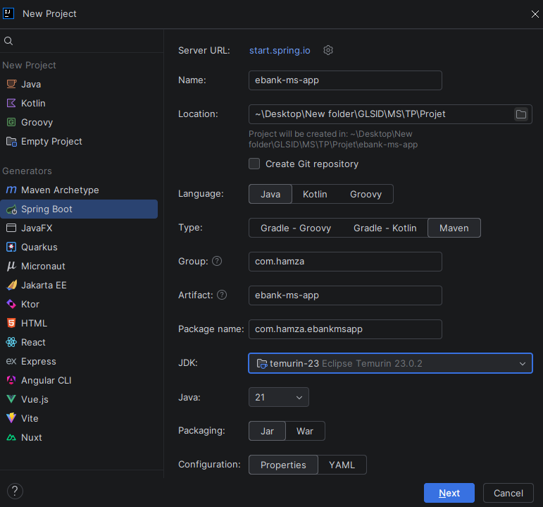

Sans dépendances.
## 2 - Développement de service Customer-Service
On Créer le micro service `customer-service` : \
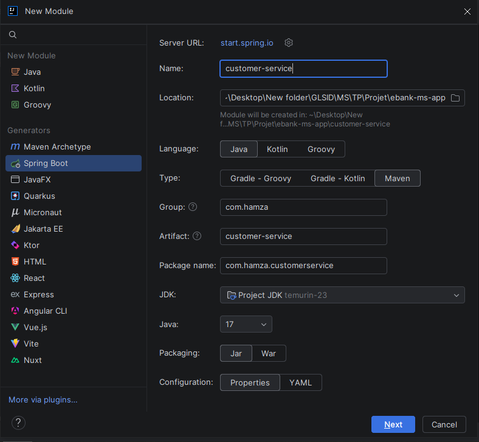 \

Avec les dépendances suivantes :
- **Spring Web**
- **Spring Data JPA**
- **H2 Database**
- **Lombok**
- **Rest Repository**
- **Eureka Discovery Client**
- **Config Client**
- **Spring Boot Actuator** \

apres la creation de entitie `Customer` et repository `CustomerRepository`, et la configuration de `application.properties` avec numero de port `8081` et l'ajoute des clients dans `CustomerServiceApplication` utilisons le `CommandeLineRunner`. \
on tester

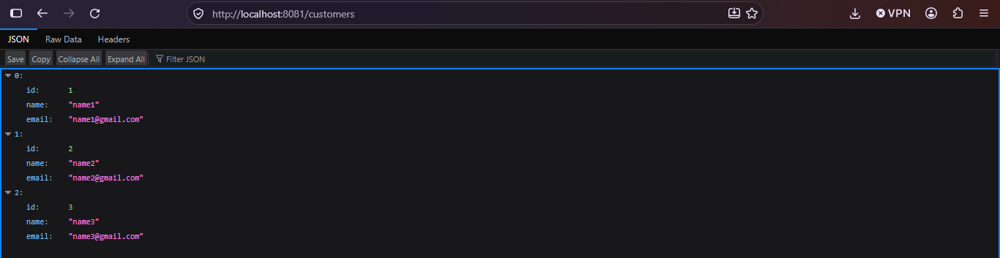 \
On ajoutons la dependance swager : \
```xml
   <dependency>
      <groupId>org.springdoc</groupId>
      <artifactId>springdoc-openapi-starter-webmvc-ui</artifactId>
      <version>3.1.1</version>
   </dependency>
```
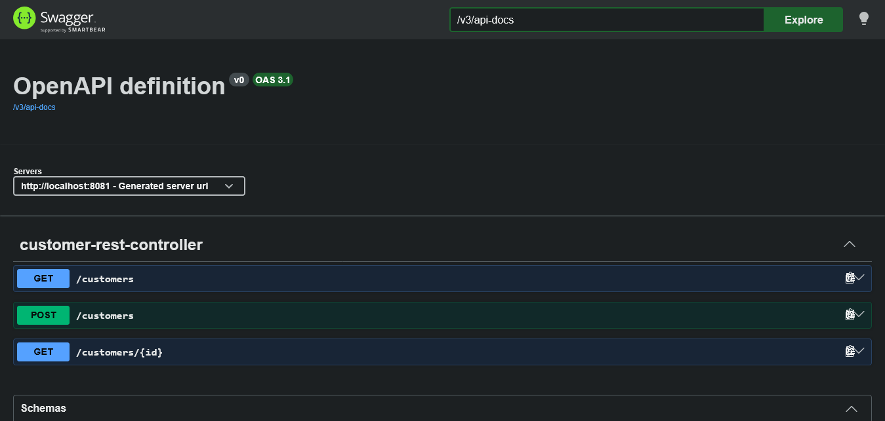 \

## 3 - Développement de service EBank-Service
On Créer le micro service `Ebank-service` : \
 \

Avec les dépendances suivantes :
- **Spring Web**
- **Spring Data JPA**
- **H2 Database**
- **Lombok**
- **Eureka Discovery Client**
- **Config Client**
- **Spring Boot Actuator** \

apres la creation de entitie `BankAccount` et repository `BankAccountRepository`, et la configuration de `application.properties` avec numero de port `8082` et l'ajoute des clients dans `EbankServiceApplication` utilisons le `CommandeLineRunner`. \
on tester

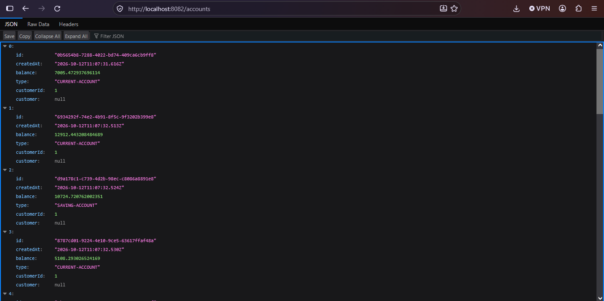 \

On ajoutons la dependance swager : \
```xml
   <dependency>
      <groupId>org.springdoc</groupId>
      <artifactId>springdoc-openapi-starter-webmvc-ui</artifactId>
      <version>3.1.1</version>
   </dependency>
```
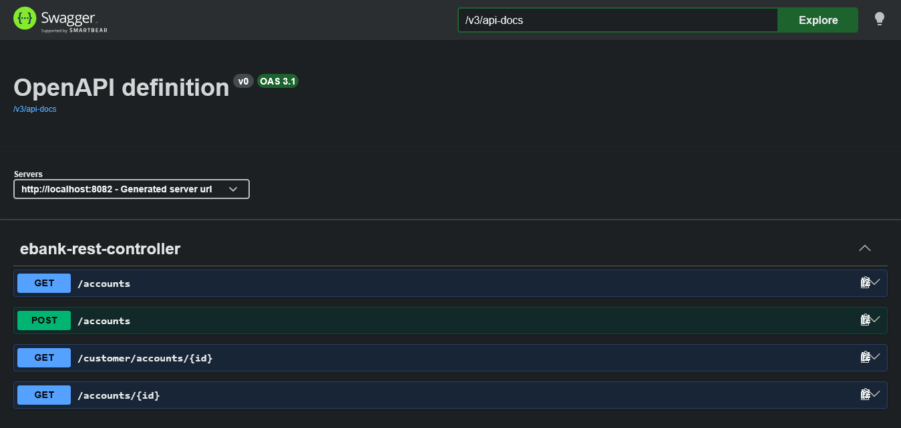 \

# 4 - Communication avce les deux services avec Open FEIGN et Fault Tolerance avec Circuit Breaker : Resilience4J
On ajoutons la dependance de `openFeign` dans le microservice `ebank-service`, apres on ajoutans
le package `feign` et l'interface `CustomerRestClient` \

```java
@FeignClient(name = "customer-service")
public interface CustomerRestClient {
    @GetMapping("/customers/{id}")
    @CircuitBreaker(name="customerService", fallbackMethod = "getDefaultCustomer")
    Customer getCustomerById(@PathVariable Long id);

    default Customer getDefaultCustomer(Long id, Exception e) {
        return new Customer(id, "NoName", "NoEmail");
    }
}
```
on ajoutons la notation de `openFeign` dans `EbamkServiceApplication`
```java
@EnableFeignClients
```
avec `CircuitBreaker` qui gerer lorsque le `customer-service` est n'est pas fonctioner. \
pour utiliser `CircuitBreaker` il faut ajouter la depandance.
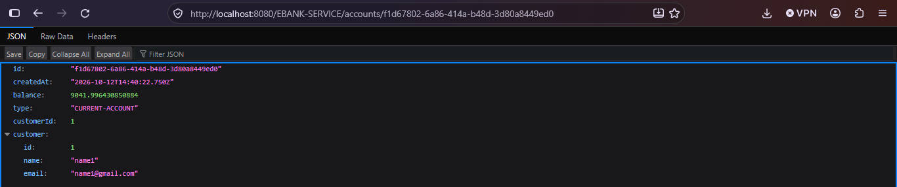 \
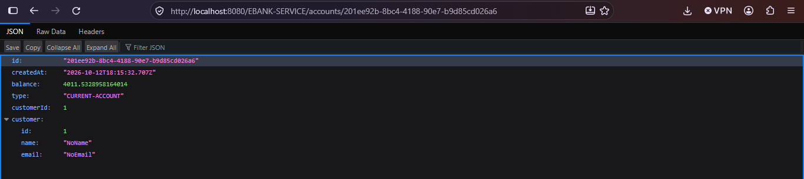 \

# 5 - Développement de gateway
On Créer le gateway `gateway-service` : \
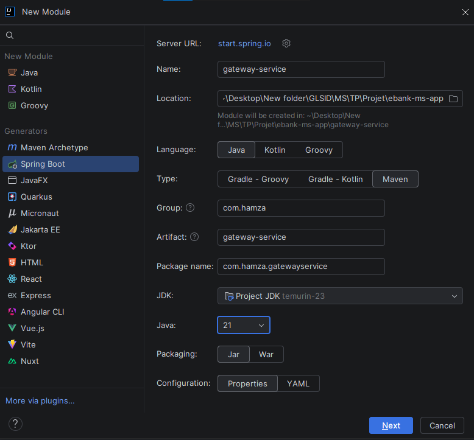 \

Avec les dépendances suivantes :
- **Reactive Gateway**
- **Eureka Discovery Client**
- **Spring Boot Actuator**  \

On creer le gateway :
- **static** : on creer un fichier `application.yaml`
```yaml
spring:
spring:
  cloud:
    gateway:
      server:
        webflux:
          routes:
            - id : r1
              uri : http://localhost:8081
              predicates:
                - Path= /customers/**
            - id : r2
              uri : http://localhost:8082
              predicates:
                - Path= /accounts/**
```
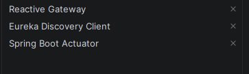 \
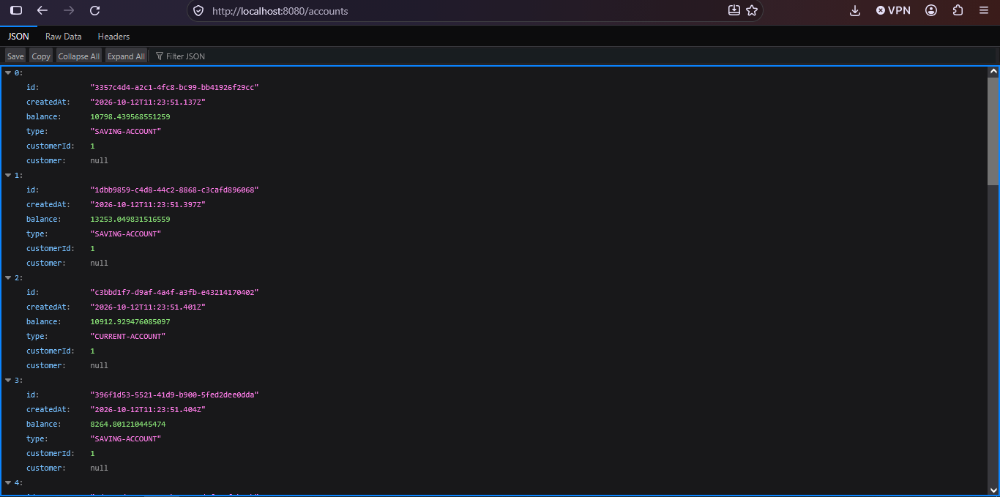 \

- **dynamic :** dans `GatewayServiceApplication`
```java
@Bean
DiscoveryCLientRouteDefinitionLocator dynamicRoutes(ReactiveDiscoveryClient rdc,
DiscoveryLocatorProperties dlp){
	return new DiscoveryClientRouteDefinitionLocator(rdc,dlp);
}
```
## 5 - Développement le Discovery Service
On Créer `discovery-service` : \
 \

Avec les dépendances suivantes :
- **Eureka Server**
- **Spring Boot Actuator** //pour le monitoring du micro service \

apres on ajoutons l'annotation dans `DiscoveryServiceApplication`
```java
@EnableEurekaServer
```
et avec la configuration
```text
spring.application.name=discovery-service
server.port=8761
eureka.client.fetch-registry=false
eureka.client.register-with-eureka=false
```
et activer spring cloud discovery de tous les autre micro service (customer, inventory, et gateway)
```text
spring.cloud.discovery.enabled=true
```
on le test
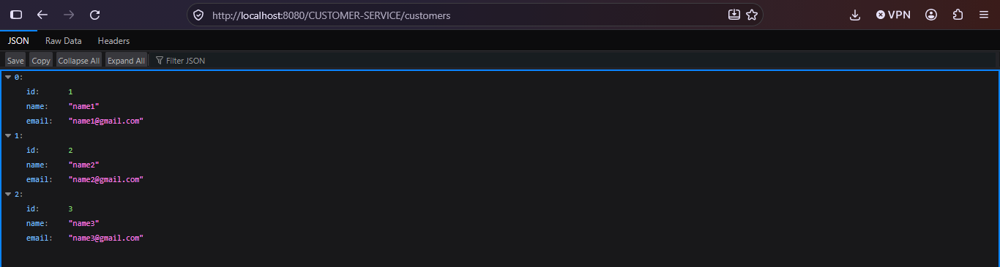
et on teste le gateway dynamique :
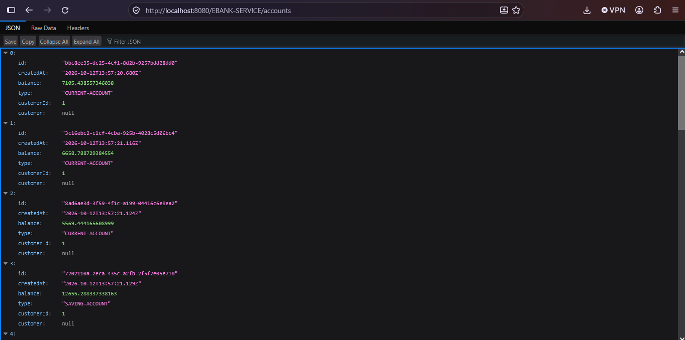

```text
NOTE : il faut ajouter dans application.properties de les deux micro service inventory-service
et customer-service :
eureka.instance.prefer-ip-address=true
pour ils fonctions avec gateway dynamique.
```
