# Rapport de Projet - Systèmes Distribués - PARTIE 01

**Référence :** https://www.youtube.com/watch?v=JHvxSZTWSsY
**Réalisé par :** HAMZA ELCADI - GLSID3

---

## 1 - Développer l'Agent AI basé sur Spring AI

On crée un module Spring Boot `ebank-bot` :

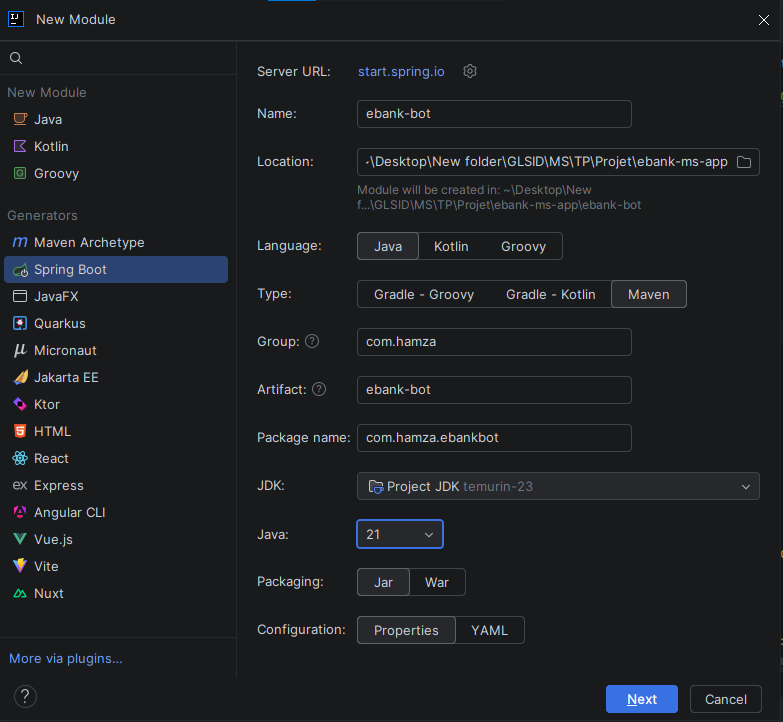

Avec les dépendances suivantes :
- **Spring Web**
- **OpenAI**
- **Eureka Discovery Client**
- **Config Client**
- **Spring Boot Actuator** \

On configure le fichier `application.properties` :
```properties
spring.application.name=ebank-bot
spring.ai.openai.api-key=API_KEY
spring.ai.openai.chat.options.model=gpt-4o
spring.cloud.discovery.enabled=true
spring.cloud.config.enabled=false
server.port=8083
```
On crée `EbankChatbotController` :
```java
@RestController
public class EbankChatbotController {
    private ChatClient chatClient;
    public EbankChatbotController(ChatClient.Builder chatClient) {
        this.chatClient = chatClient.build();
    }
    @GetMapping("/chat")
    public String chat(@RequestParam(name = "query", defaultValue = "Bonjour") String query){
        return chatClient.prompt(query).call().content();
    }
}
```
On utilise la documentation Swagger : \
on ajoute la dépendance `OpenAPI` :
```xml
   <dependency>
      <groupId>org.springdoc</groupId>
      <artifactId>springdoc-openapi-starter-webmvc-ui</artifactId>
      <version>3.1.1</version>
   </dependency>
```

On lance les services `discovery-client` et `Ebank-bot`, puis on accède à `http://localhost:8083/chat?query=hello`.
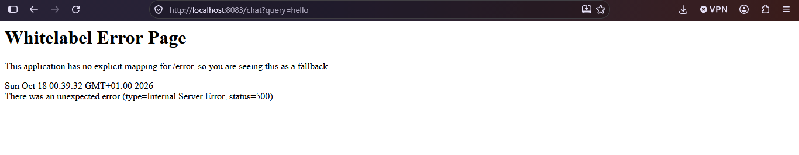 \
Note : la page ne fonctionne pas à cause de cette erreur : \
```text

2026-10-18T00:39:32.434+01:00 ERROR 17472 --- [ebank-bot] [nio-8083-exec-3] o.a.c.c.C.[.[.[/].[dispatcherServlet]    : Servlet.service() for servlet [dispatcherServlet] in context with path [] 
threw exception [Request processing failed: com.openai.errors.RateLimitException: 429: 
You have no credits remaining. Add credits to continue using the API at https://platform.openai.com/settings/organization/billing/.] with root cause
```
Elle indique que 'You have no credits remaining. Add credits to continue using the API', c'est-à-dire qu'il n'y a plus de crédits.
Donc on va utiliser `Gemini`.
- 1 : on ajoute la dépendance
```xml
<dependency>
    <groupId>org.springframework.ai</groupId>
    <artifactId>spring-ai-starter-model-google-genai</artifactId>
</dependency>
```
- 2 : on modifie `application.properties`
```properties
spring.application.name=ebank-bot
#spring.ai.openai.api-key=${API_KEY}
#spring.ai.openai.chat.options.model=gpt-4o
spring.ai.google.genai.api-key=${GEMINI_API_KEY}
spring.ai.google.genai.chat.model=gemini-3.8-flash
spring.cloud.discovery.enabled=true
spring.cloud.config.enabled=false
server.port=8083
```
On le teste avec `http://localhost:8083/chat?query=hello` \
 \
On consulte la documentation `Swagger` : \
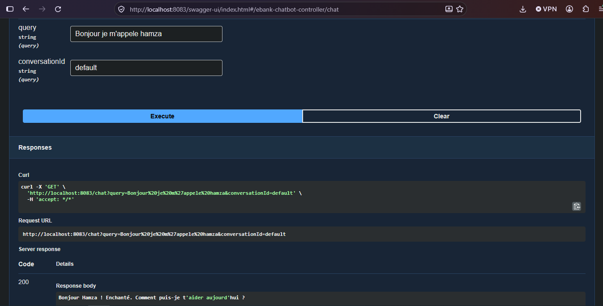 \
Note : le LLM est stateless, c'est-à-dire qu'il n'a pas de mémoire. \
On ajoute donc une mémoire au LLM.
```java
public EbankChatbotController(ChatClient.Builder chatClient, ChatMemory chatMemory) {
    this.chatClient = chatClient
            .defaultAdvisors(MessageChatMemoryAdvisor.builder(chatMemory).build())
            .build();
}
@GetMapping("/chat")
public String chat(
        @RequestParam(name = "query", defaultValue = "Bonjour") String query,
        @RequestParam(name = "conversationId", defaultValue = "default") String conversationId) {

    return chatClient.prompt()
            .user(query)
            .advisors(advisor -> advisor.param(
                    ChatMemory.CONVERSATION_ID, conversationId))
            .call()
            .content();
}
```
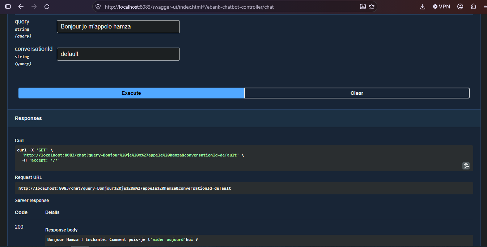 \
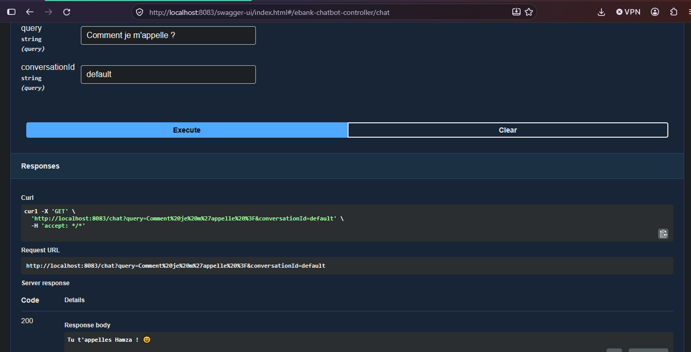 \
Le LLM a donc maintenant une mémoire, car il a retenu mon nom. \
Maintenant, on crée une classe `EbankAIAgent` dans le package `agents`.
```java
@Service
public class EbankAIAgent {
    private final ChatClient chatClient;

    public EbankAIAgent(
            ChatClient.Builder chatClient,
            ChatMemory chatMemory) {

        this.chatClient = chatClient
                .defaultAdvisors(
                        MessageChatMemoryAdvisor.builder(chatMemory).build())
                .build();
    }
    public String chat(String query, String conversationId) {

        return chatClient.prompt()
                .user(query)
                .advisors(advisor -> advisor.param(
                        ChatMemory.CONVERSATION_ID, conversationId))
                .call()
                .content();
    }
}
```
Puis on modifie `EbankChatbotController` :
```java
@RestController
public class EbankChatbotController {

    EbankAIAgent ebankAIAgent;
    public EbankChatbotController(EbankAIAgent ebankAIAgent) {
        this.ebankAIAgent = ebankAIAgent;
    }


    @GetMapping("/chat")
    public String chat(
            @RequestParam(name = "query", defaultValue = "Bonjour") String query,
            @RequestParam(name = "conversationId", defaultValue = "default") String conversationId) {

        return ebankAIAgent.chat(query, conversationId);
    }
}
```

## 2 - Exposition des fonctionnalités des micro-services via MCP
On ajoute le serveur `MCP` (Model Context Protocol) dans `customer-service` : \
```xml
<dependency>
    <groupId>org.springframework.ai</groupId>
    <artifactId>spring-ai-starter-mcp-server-webmvc</artifactId>
</dependency>
```
On ajoute dans `CustomerService` l'annotation `@McpTool`, qui transforme les méthodes du service en outils que l'agent AI peut utiliser.
```java
@Service
public class CustomerService {
    private CustomerRepository customerRepository;

    public CustomerService(CustomerRepository customerRepository){
        this.customerRepository = customerRepository;
    }

    @McpTool(description = "Get all customers")
    public List<Customer> getAllCustomers() {
        return customerRepository.findAll();
    }

    @McpTool(description = "Find a customer by id")
    public Customer findCustomerById(@McpToolParam(description = "The customer id") Long id) {
        return customerRepository.findById(id)
                .orElseThrow(() -> new RuntimeException("Customer "+id+" not found"));
    }

    @McpTool(description = "Save new customer")
    public Customer saveCustomer(@McpToolParam(description = "The customer to save (name, email)") Customer customer){
        return customerRepository.save(customer);
    }
}
```
N'importe quel agent qui connaît l'adresse du service peut accéder à ces méthodes via MCP. \
On ajoute la configuration MCP dans le micro-service `customer-service` :
```properties
spring.ai.mcp.server.protocol=streamable
```
`streamable` permet une communication bidirectionnelle entre l'agent et le micro-service.

## 3 - Tester les micro-services via MCP Client
On le teste avec `Postman`.

## 4 - Connecter le chatbot aux micro-services avec MCP
On ajoute la dépendance `mcp-client` dans le service `ebank-bot` :
```xml
dependency>
    <groupId>org.springframework.ai</groupId>
    <artifactId>spring-ai-starter-mcp-client</artifactId>
</dependency>
```
Puis on configure :
```properties
spring.ai.mcp.client.streamable-http.connections.customers.url=http://localhost:8081/mcp
```
Puis on ajoute dans le service `EbankAIAgent` la fonctionnalité qui, au démarrage, va chercher les outils :
```java
public EbankAIAgent(
        ChatClient.Builder chatClient,
        ChatMemory chatMemory,
        ToolCallbackProvider tools) {

    this.chatClient = chatClient
            .defaultAdvisors(
                    MessageChatMemoryAdvisor.builder(chatMemory).build())
//                .defaultToolCallbacks(tools)
            .defaultTools(tools)
            .build();
}
```
On le teste en demandant la liste des clients :
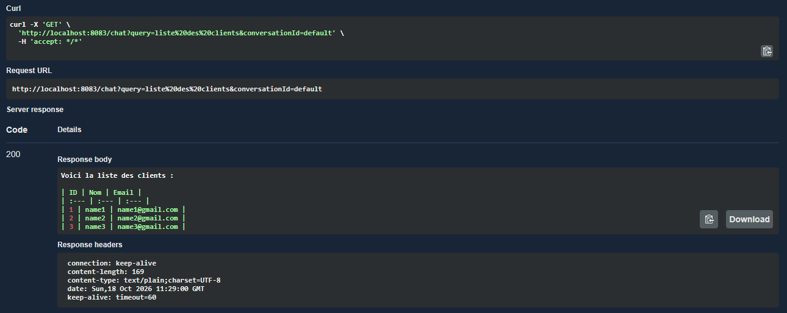 \

On lui demande le nom du client numéro 1 :
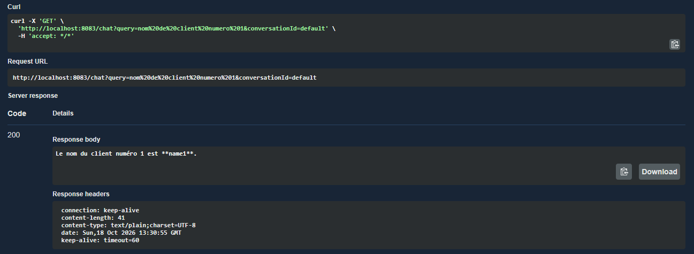 \

Maintenant, on va délimiter et limiter le chatbot pour qu'il réponde uniquement aux questions concernant les clients et les comptes. \
On ajoute `defaultSystem` dans `EbankAIAgent` :
```java
public EbankAIAgent(
        ChatClient.Builder chatClient,
        ChatMemory chatMemory,
        ToolCallbackProvider tools) {

    this.chatClient = chatClient
            .defaultSystem("""
                    Vous un assistant qui se charge de repondre aux question
                    de l'utilsateur a propos des clients et des compte bancaires, en fonction du contexte fourni.
                    Si aucun contexte n'est fourni, repond avec JE NE SAIT PAS.
                    """)
            .defaultAdvisors(
                    MessageChatMemoryAdvisor.builder(chatMemory).build())
//                .defaultToolCallbacks(tools)
            .defaultTools(tools)
            .build();
}
```
On le teste avec le prompt `je veux manger` :
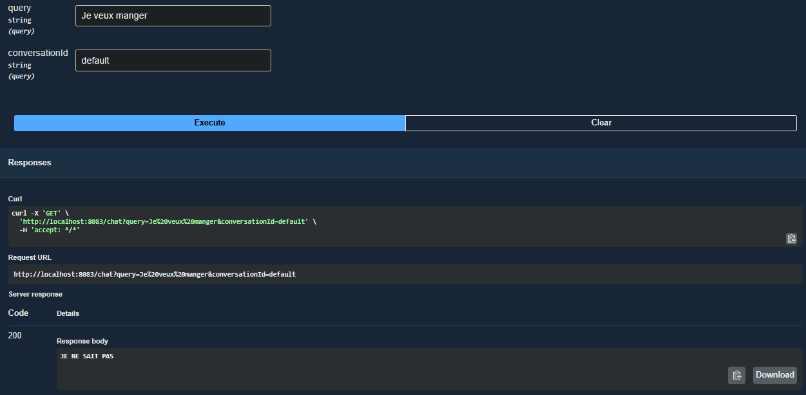 \

On fait la même chose avec `Ebank-service`. \
On ajoute la dépendance `mcp` :
```xml
<dependency>
    <groupId>org.springframework.ai</groupId>
    <artifactId>spring-ai-starter-mcp-server-webmvc</artifactId>
</dependency>
```
Puis on ajoute les annotations `MCP` dans `EbankService` :
```java
@Service
public class EbankService {
    BankAccountRepository bankAccountRepository;
    CustomerRestClient customerRestClient;
    public EbankService(BankAccountRepository bankAccountRepository, CustomerRestClient customerRestClient) {
        this.bankAccountRepository = bankAccountRepository;
        this.customerRestClient = customerRestClient;

    }

    @McpTool(description = "Get all Bank accounts")
    public List<BankAccount> getAllBankAccounts() {
        return bankAccountRepository.findAll();
    }

    @McpTool(description = "Get Bank Account by id")
    public BankAccount getBankAccountById(@McpToolParam(description = "The bank account id") String id) {
        BankAccount bankAccount =  bankAccountRepository.findById(id)
                .orElseThrow(() -> new RuntimeException("bankAccount not found"));
        bankAccount.setCustomer(customerRestClient.getCustomerById(bankAccount.getCustomerId()));
        return bankAccount;
    }

    @McpTool(description = "save a customer")
    public BankAccount saveBankAccount(@McpToolParam(description = "The bank account to save ()") BankAccount bankAccount) {
        try {
            Customer customer = customerRestClient.getCustomerById(bankAccount.getCustomerId());
            bankAccount.setId(UUID.randomUUID().toString());
            bankAccount.setCreatedAt(new Date());
            return bankAccountRepository.save(bankAccount);
        } catch (Exception e) {
            throw new RuntimeException(e.getMessage());

        }
    }
}
```
Et on ajoute la configuration MCP dans `application.properties` :
```properties
spring.ai.mcp.client.streamable-http.connections.ebank.url=http://localhost:8082/mcp
```
Remarque : la clé API fournie sur Classroom a été publiée sur GitHub et n'est donc plus fonctionnelle, et les limites d'utilisation de Gemini sont rapidement atteintes.
Je ne peux donc pas fournir de captures d'écran illustrant le fonctionnement du chatbot.

On améliore l'affichage de la réponse du chatbot, \
dans `EbankChatbotController` :
```java
    @GetMapping("/chat", produces = MediaType.TEXT_PLAIN_VALUE)
```

[//]: # (output using the gateway to get clients and bank accounts)
## 5 - Tester le chatbot avec un client Discord
On ajoute la dépendance `discord` dans `ebank-bot` :
```xml
<dependency>
    <groupId>com.zgamelogic</groupId>
    <artifactId>spring-boot-strater-discord</artifactId>
    <version>5.0.4</version>
</dependency>
```
On crée la classe `DiscordBot` :
```java
@DiscordController
public class DiscordBot {
    private EbankAIAgent ebankAIAgent;
    public DiscordBot(EbankAIAgent ebankAIAgent) {
        this.ebankAIAgent = ebankAIAgent;
    }
    @DiscordMapping
    private void perform(MessageReceiveEvent event) {
        System.out.println(event);
        if(event.getAuthor().isBot()) return;
        String query = event.getMessage().getContentRaw();
        String response = ebankAIAgent.chat(new Prompt(query));
        event.getChannel().sendMessage(response).queue();
    }
}
```
Et on modifie `application.properties` :
```properties
discord.token=${DISCORD_TOKEN}
```
Pour obtenir `DISCORD_TOKEN`, on accède à `https://discord.com/developers/applications?new_application=true` \
On crée une application \
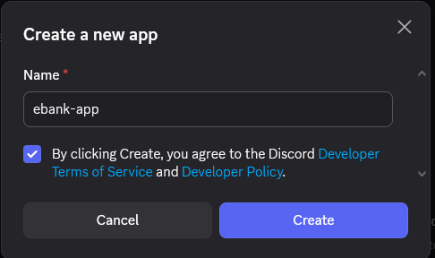 \
Puis on ouvre l'onglet `bot`, puis `Reset Token` \
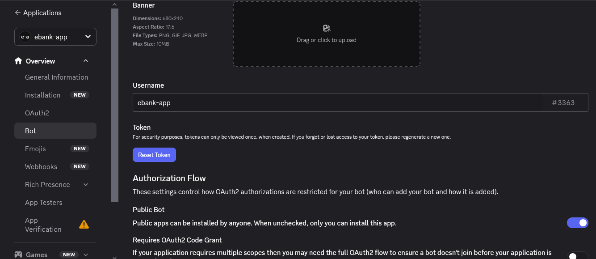 \
Puis on active les droits :
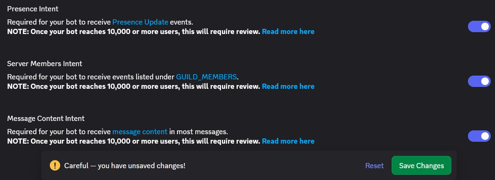 \
Puis on crée un serveur Discord \
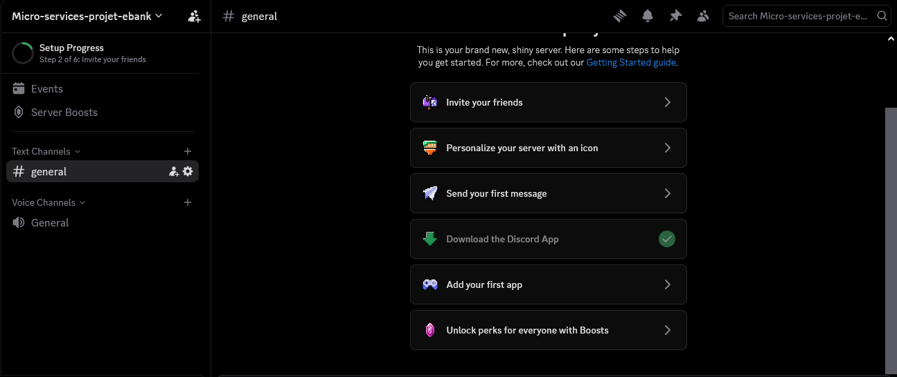 \
Puis on ouvre l'onglet Installation dans `https://discord.com/developers/applications/`,
on copie le lien d'installation de l'application et on ajoute le bot à un serveur. \
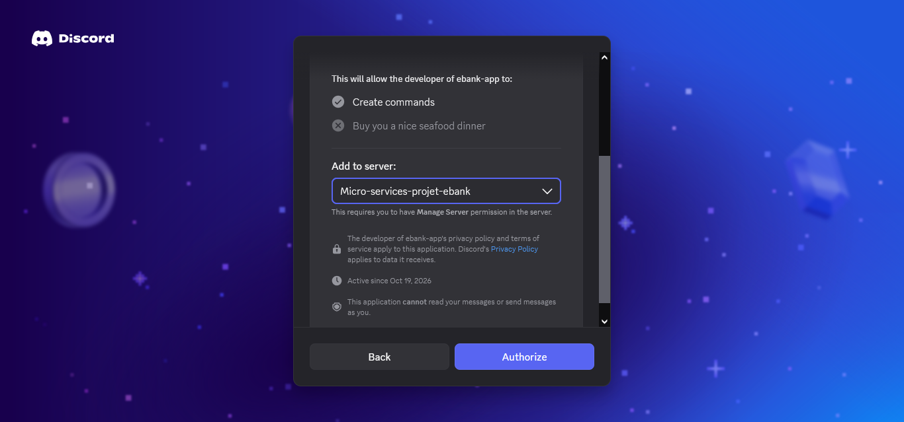 \


## 6 - Tester le chatbot avec un client Telegram
On ajoute la dépendance `telegram` dans `ebank-bot` :
```xml
<dependency>
    <groupId>org.telegram</groupId>
    <artifactId>telegrambots-spring-boot-strater</artifactId>
    <version>6.9.7.1</version>
</dependency>
```
Ensuite, on crée un bot avec `BotFather` :
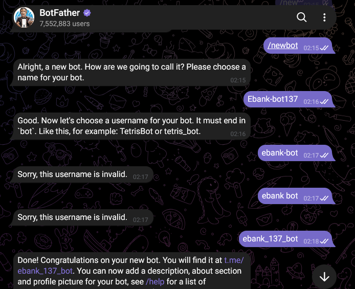 \
Puis on ajoute dans `application.properties` :
```properties
telegram.token=${TELEGRAM_TOKEN}
```
Et dans la classe `telegram.TelegramBot` :
```java
@Component
public class TelegramBot extends TelegramLongPollingBot {
    @Value("${telegram.token}")
    private String telgramBotToken;
    private EbankAIAgent aiAgent;
    public TelegramBot(EbankAIAgent aiAgent) {
        this. aiAgent = aiAgent;
    }
    @PostConstruct
    public void registerTelegramBot() {
        try{
            TelegramBotsApi api = new TelegramBotsApi(DefaultBotSession.class);
            api.regiserBot(this);
        } catch (TelegramApiException e) {
            throw new RuntimeException(e);
        }
    }
    @Override
    public void onUpdateReceived(Update telegramRequest) {
        try {
            if(!telegramRequest.hasMessage()) return;
            String messageText = telegramRequest.getMessage().getText();
            Long chatId = telegramRequest.getMessage().getChatId();
            List<PhotoSize> photos = telegramRequest.getMessage().getPhoto();
            List<Media> mediaList = new ArrayList<>();
            String caption = null;
            if(photos != null) {
                caption = telegramRequest.getMessage().getCaption();
                if(caption == null) caption = "What do you see in this image";
                for(PhotoSize ps : photos) {
                    String fileId = ps.getFileId();
                    GetFile getFile = new GetFile();
                    getFile.setFileId(fileId);
                    File file = execute(getFile);
                    String filePath = file.getFilePath();
                    String textUrl = "https://api.telegram.org/file/bot"
                            +getBotToken()+"/"+filePath;
                    URL fileUrl = new URL(textUrl);
                    mediaList.add(Media.builder()
                            .id(fileId)
                            .mimeType(MimeTypeUtils.IMAGE_PNG)
                            .data(new UrlResource(fileUrl))
                            .build());
                }
            }
            String query = messageText != null?messageText:caption;
            UserMessage userMessage = UserMessage.builder()
                    .text(query)
                    .media(mediaList)
                    .build();
            sendTypingQuestion(chatId);
            String answer = aiAgent.chat(new Prompt(userMessage));
            sendTextMessage(chatId, answer);

        } catch (Exception e) {
            throw new RuntimeException(e);
        }
    }
}
```
On modifie le paramètre `query` : de `String`, il devient un `Prompt`,
dans `EbankChatbotController` : \
```java
@GetMapping("/chat", produces = MediaType.TEXT_PLAIN_VALUE)
    public String chat(
            @RequestParam(name = "query", defaultValue = "Bonjour") String query,
            @RequestParam(name = "conversationId", defaultValue = "default") String conversationId) {

        return ebankAIAgent.chat(new Prompt(query), conversationId);
    }
```
Dans `DiscordBot.java` :
```java
@Component
public class TelegramBot extends TelegramLongPollingBot {
    @Value("${telegram.token}")
    private String telgramBotToken;
    private EbankAIAgent aiAgent;
    public TelegramBot(EbankAIAgent aiAgent) {
        this. aiAgent = aiAgent;
    }
    @PostConstruct
    public void registerTelegramBot() {
        try{
            TelegramBotsApi api = new TelegramBotsApi(DefaultBotSession.class);
            api.regiserBot(this);
        } catch (TelegramApiException e) {
            throw new RuntimeException(e);
        }
    }
    @Override
    public void onUpdateReceived(Update telegramRequest) {
        try {
            if(!telegramRequest.hasMessage()) return;
            String messageText = telegramRequest.getMessage().getText();
            Long chatId = telegramRequest.getMessage().getChatId();
            List<PhotoSize> photos = telegramRequest.getMessage().getPhoto();
            List<Media> mediaList = new ArrayList<>();
            String caption = null;
            if(photos != null) {
                caption = telegramRequest.getMessage().getCaption();
                if(caption == null) caption = "What do you see in this image";
                for(PhotoSize ps : photos) {
                    String fileId = ps.getFileId();
                    GetFile getFile = new GetFile();
                    getFile.setFileId(fileId);
                    File file = execute(getFile);
                    String filePath = file.getFilePath();
                    String textUrl = "https://api.telegram.org/file/bot"
                            +getBotToken()+"/"+filePath;
                    URL fileUrl = new URL(textUrl);
                    mediaList.add(Media.builder()
                            .id(fileId)
                            .mimeType(MimeTypeUtils.IMAGE_PNG)
                            .data(new UrlResource(fileUrl))
                            .build());
                }
            }
            String query = messageText != null?messageText:caption;
            UserMessage userMessage = UserMessage.builder()
                    .text(query)
                    .media(mediaList)
                    .build();
            sendTypingQuestion(chatId);
            String answer = aiAgent.chat(new Prompt(userMessage));
            sendTextMessage(chatId, answer);

        } catch (Exception e) {
            throw new RuntimeException(e);
        }
    }

    @Override
    public String getBotUsername(){return "ebank_137_bot";}

    @Override
    public String getBotToken() {return telgramBotToken;}

    public void sendTextMessage(Long chatId, String text) throws TelegramApiException {
        SendMessage sendMessage = new SendMessage(String.valueOf(chatId), text);
        execute(sendMessage);
    }

    private void sendTypingQuestion(Long chatId)throws TelegramApiException{
        SendChatAction sendChatAction = new SendChatAction();
        sendChatAction.setChatId(String.valueOf(chatId));
        sendChatAction.setAction(ActionType.TYPING);
        execute(sendChatAction);

    }
}
```
Puis on résout le conflit entre `telegram` et `discovery-service`. \
Dans le fichier `application.properties`, on ajoute :
```properties
eureka.client.jersey.enabled=flase
```
Le `discovery-service` a déjà créé ce bean, il n'est donc pas nécessaire de le créer dans Telegram.

[//]: # (image de tesing le bot utilisant telegram)